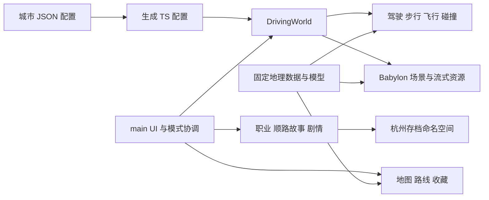

# 架构与代码地图

运行链：`index.html` → `src/release-entry.ts` 手动启动 → `src/main.ts` → `DrivingWorld`。生产构建先用锁定 esbuild 打包完整游戏，再让 Vite 处理小入口，避免第二次解析整个 Babylon 包。资源从同源 `public/` 复制到 `dist/`，无在线地图 API 依赖。

| 领域 | 重点代码 | 修改时保护 |
| --- | --- | --- |
| 世界生命周期与互斥 | `city-world.ts`、`main.ts` | 不创建第二套重复场景/输入循环；离开模式释放或停用资源 |
| 汽车与通行 | `driving.ts`、`road-access.ts`、`city-road-levels.ts`、`city-site-surfaces.ts` | 高架/地面分层、实际车体支撑、路权与水域限制 |
| 步行/骑行/坦克/飞机 | `city-walk.ts`、`city-bicycle.ts`、`city-tank.ts`、`city-flight.ts` | 参数、切换条件、弹药特效池、碰撞与恢复 |
| 地图与自动驾驶 | `city-map.ts`、`navigation.ts`、`city-autopilot.ts` | 可达道路目标、方向/层级连接、信号等待 |
| 经济和任务 | `city-life.ts`、`city-career.ts`、`city-story.ts`、`city-story-content.ts` | 奖励、升级价格、分支、互斥和幂等结算 |
| 休闲与公交 | `city-leisure*.ts`、`city-bus*.ts` | 主城会话与原玩法互斥；公交模块存在不等于整线已接入 |
| 咖啡馆 | `city-bamboo-cafe.ts`、`city-cafe-layout.ts`、`city-cafe-staff-motion.ts` | 虚构内景保持游戏尺寸；入口、地板、角色锚点和相机 |
| 分块和材质 | `city-base-stream.ts`、`city-stream-*.ts`、`city-facade-stream.ts` | 预算、取消、释放、共享材质、反射更新与实例化 |
| 天气/画质 | `city-daylight.ts`、`city-rain-weather.ts`、`city-graphics-*.ts` | 低画质单次渲染；灯光/材质配置稳定；雪粒子不代表地面积雪 |
| 城市参数 | `city-config.ts`、`city-profiles.generated.ts`、`city-narrative.ts` | 原点、投影、地名、存档一致性 |

## 数据边界

基础城市和 road-levels 已拆为 JSON 块；地形、道路、普通楼体共 1912 个基础模型块。`city-stream-profile.ts` 限制兼容可见范围，预算和迟滞由流规划模块管理。该策略保留几何与碰撞数据，不把看不见当作可穿过。

重点地标是基础城市增量。集成对象时同步更新基础楼体/近景立面排除、碰撞、地图、到达点和清单；只替换 GLB 会出现叠楼或错误入口。水体进入基础水面管线，不能依赖容易被过滤的候选薄片。

运行存档由 `config/cities/hangzhou.json` 定义 `gta-hz` 前缀，继续保持原结构/恢复行为。协议、域名和端口改变会切换浏览器 origin，不应当作清档代码缺陷。职业与剧情经济不可被调试移动计为真实驾驶验收。

独立 `combat-lab.html` 用于靶场。`trailer.html` / `src/trailer-capture.ts` 保留旧录制工具源码，其深圳镜头、道路 ID 与整城初始化待迁移，不随默认 `dist` 发布。`src/world.ts` 是旧试点街区实现，不是当前主城入口。`ue5/` 保留实验源码与配置，缺失导入资源不是浏览器构建依赖。
