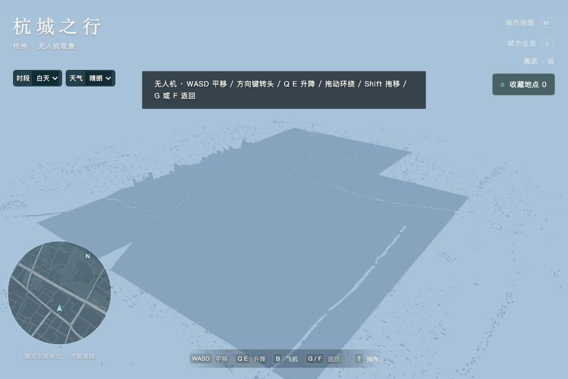
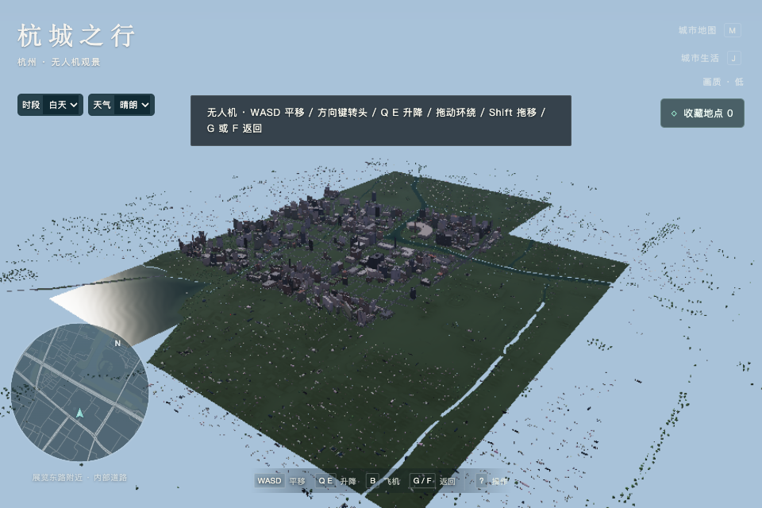

# 空中浓雾修复验证

日期：2026-11-16。基于 RC3，本机修复；原 RC3 Release 与资源包未改写。

这是先完成的雾效修复记录。随后用户要求取消远景性能限制，当前主城已恢复完整高空覆盖并去除全屏加载遮罩，见 [后续验证](full-view.md)。本文的 760 距离限制属于当时版本。

## 原因与修复

兼容版将场景改为线性雾，起止距离为 280/620 游戏单位。镜头升高后，地面和远处物体超过终点距离，即使天气选择晴朗也完全失去本色。昼夜和天气系统更新的 `fogDensity` 对该线性模式不起作用。

恢复原版 `Scene.FOGMODE_EXP2`，继续使用已有晴昼、日落、夜晚和天气的雾密度。移除兼容分块配置中不再使用的线性雾参数。几何加载范围、32 块驻留上限、反射、阴影和画质分辨率未调整。

## 本轮实测

- 对实际场景初始化代码的 NullEngine 检查：修复前晴天在 1,000、2,200、3,200 游戏单位均被雾完全遮挡；修复后使用日落基准密度时透射比例分别约 0.988、0.943、0.883。雪天仍保留更强的距离衰减。这是公式和配置检查，不是图像验收。
- 隔离 Chrome 软件 WebGL：低画质、白天，按 G 进入无人机视角，滚轮拉远。修复前后相机位置均为 `[1834.6668, 1187.6615, -2123.7710]`，观景距离约 2,864.8 游戏单位。
- 对比同一视角实机截图，修复后楼群、道路和地面恢复可辨识颜色；晴朗 → 阴天 → 晴朗后恢复正常。两轮均无缺失 HTTP 资源或未捕获页面错误。见 [结构化记录](aerial-fog.json)。
- `npm test`：413 通过，0 失败、0 跳过；`npm run build`：10,793 个资源校验、严格类型检查和生产构建通过。

| 修复前 | 修复后 |
| --- | --- |
|  |  |

截图为本项目渲染；地图数据 © OpenStreetMap contributors / ODbL，完整资源署名见 [第三方声明](../../THIRD_PARTY_NOTICES.md)。

## 范围与剩余限制

本轮确认浓雾问题已消除，不代表完整城市远景通过验收。普通街区仍受兼容版 760 游戏单位的分块可见范围限制，高空可见加载边界；远景 LOD、完整天际线及硬件帧时需后续单独优化验证。本轮未扩大几何预算，也未重新验证全部任务、所有飞行武器或长时间性能。

服务恢复后访问 `http://127.0.0.1:5241/`，刷新页面加载新脚本；左上角可选择「白天」「晴朗」。电脑重启会结束本地服务，可在项目目录执行 `npm run preview` 重启已有构建。
