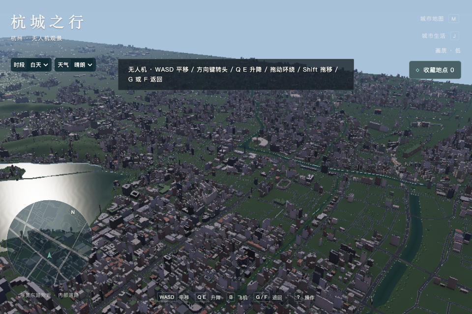

# 完整远景与连续演示

2026-11-16，基于 RC3 的本机修复。用户明确要求画面完整性优先，并取消飞行时闪出的全屏加载页面。

## 改动

- 默认请求 `full`，恢复原版地面道路 2500、楼体/地形 3300 游戏单位范围；高空使用视锥内完整原始地块，取消 760 距离截断。
- 驻留预算改为已校验清单的真实总和，取消默认主城 32 块限制。1912 个源地块的总声明成本为 428,605,528 编码字节、800,222,040 几何逻辑字节、18,612,307 三角形；这些是资产成本，不是浏览器内存实测。
- 仍逐文件验证哈希，单次导入，并保留取消、释放和共享材质管理。兼容探针保留原预算，不再用作主城默认画面限制。
- 删除 `prepareBaseFrame` 的 DOM 全屏遮罩。普通驾驶/飞行继续渲染、保留按键，新模型后台到达后应用可见性；碰撞和路高继续来自已载入的地理数据。显式快速移动等待目的地就绪再提交，期间保留上一帧，不弹遮罩。

## 验证

- 完整覆盖回归先验证旧行为失败，再修复；全套 417 项通过，0 失败/跳过。严格类型检查、10,793 资源校验及生产构建通过。
- 隔离 Chrome / 软件 WebGL，低画质、白天，合成观景输入设置同一相机位置 `[1834.6668, 1187.6615, -2123.7710]`。旧兼容视图只请求 19 个基础块；恢复后请求 475 块、约 583 万三角形，全部驻留，缺失/拒绝/加载失败均为零。
- 实机图显示城市、地形和道路延伸至远方；转动高空镜头后新视野亦完成加载。无缺失 HTTP 资源或未捕获页面错误。见 [结构化结果](full-view.json)。首次检查在视图过渡中的瞬时 ready 状态过早截图，保留失败记录；后续改为等待稳定相机、加载完成及连续渲染帧。
- 随后移除遮罩：两个针对性测试先失败再通过，连同完整覆盖、取消/释放共 8 项通过，重新生产构建通过。按用户要求立即交付演示，遮罩移除后的真人操作由用户测试；未将前一步浏览器结果冒充新一轮完整实机回归。

图为遮罩移除前、完整加载结束后的本轮实机画面。地图数据 © OpenStreetMap contributors / ODbL；美术署名见 [第三方声明](../../THIRD_PARTY_NOTICES.md)。

完整视野会增加首轮加载、内存与绘制成本。后台加载的新视野可逐步补齐；本轮未做硬件帧时、连续高速飞行或长时间稳定性验收。资源包与原 RC3 tag 未改写。
